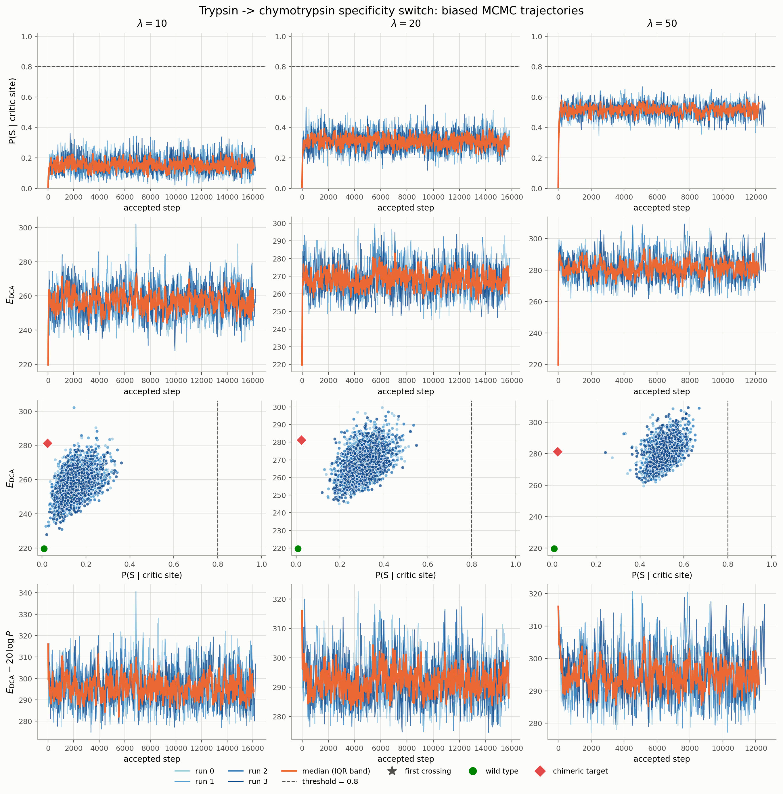

# Trypsin → chymotrypsin specificity switch by biased MCMC

Sampling sequences that start from wild-type rat trypsin (TRY2_RAT) and move
toward a chymotrypsin-like S1 pocket, under a bmDCA (Potts) model trained with
[adabmDCA 2.1](https://github.com/spqb/adabmDCApy).



The sampled Hamiltonian is

```
H(seq) = beta * E_DCA(seq) - lambda * log P(S | critic_site, seq)
```

* `E_DCA` is the Potts statistical energy, computed by
  `adabmDCA.statmech.compute_energy`:
  `E = -sum_i h_i(s_i) - 0.5 sum_{i,j} J_ij(s_i, s_j)`.
* `P(S | critic_site, seq)` is the model's single-site conditional at the
  specificity-switching site (3TGI position **189**: Asp in trypsin, Ser in
  chymotrypsin), evaluated on Serine. It uses adabmDCA's own Gibbs logits
  (`bias[i] + couplings[i] · x`, as in `adabmDCA.sampling`), so it is exactly
  the conditional of `exp(-beta E)` — nothing is fitted on the side.
* **lambda is the bias strength: the larger it is, the harder the chain is
  pulled toward Ser at the critic site**, and the more DCA energy it will pay
  for it. `lambda = 0` is plain Potts sampling at inverse temperature `beta`.

A move substitutes one residue at one allowed site by another non-gap residue,
drawn uniformly, so the proposal is symmetric and the Metropolis–Hastings
acceptance is `min(1, exp(-dH))`. A chain stops when
`P(S | critic_site) >= threshold` (default 0.80) or after `--max-steps` proposed
moves, and records its state every `--record-every` *accepted* moves.

Two consequences of the definitions, both used by the sampler:

* `P(S | critic_site, seq)` conditions on *the rest of the sequence*, so it does
  not depend on the residue currently at the critic site. A move there changes
  `E_DCA` only.
* Gap columns are never mutated, and a gap is never proposed as a new residue.

## Install

```bash
git clone <this repo> && cd trypsin_specificity_switch
pip install -e .
pip install -e ".[dev]" && pytest     # optional, ~5 s
```

Python >= 3.10. adabmDCA 2.1 is on PyPI as `adabmDCA` (version `1.0.0`) and is
pulled in automatically, together with torch, numpy, pandas, matplotlib and
joblib.

## Conventions (adabmDCA's)

* **Alphabet**: adabmDCA's `protein` tokens, `-ACDEFGHIKLMNPQRSTVWY`, **gap
  first** (index 0). Tokens come from `adabmDCA.alphabet.get_tokens`, encoding
  and decoding from `adabmDCA.fasta.encode_sequence` / `decode_sequence`, FASTA
  I/O from `adabmDCA.Alignment` / `read_alignment` / `write_alignment`. Pass
  `--alphabet` to override (e.g. `ACDEFGHIKLMNPQRSTVWY-` for the gap-last
  convention of the old Julia notebooks); the same token string is used to read
  the parameter file and the sequences, and energies are invariant under the
  relabelling (there is a test).
* **Parameters** are read by `adabmDCA.load_model`, which expects the `h`/`J`
  text records adabmDCA writes. Loading checks that the self-couplings
  `J[i, :, i, :]` vanish, which the conditional and the substitution energy
  assume.
* **MSA columns are 0-based** everywhere, including in `trajectory.csv`. A
  mapping CSV written by the Julia pipeline, where the first column is 1, is
  read with `--mapping-base 1`.

## Inputs

| Input | What it is |
|---|---|
| `--wt` | FASTA with the **aligned** (gapped) wild-type row, of the model's length `L` |
| `--model` | the adabmDCA parameter file, or a directory holding exactly one |
| `--mapping` | *(optional)* CSV with columns `pdb_residue` and `msa_col`, mapping 3TGI residue labels (`188A` included) to MSA columns |

`data/` ships the three aligned MSA rows (L = 260) used here:
`wt_trypsin.fasta` (TRY2_RAT, the MCMC start), `chymotrypsin_bovine.fasta` and
`chymotrypsin_rat.fasta` (chimera donors). The bmDCA parameter file is hundreds
of megabytes and is **not** in the repo — keep it outside and point `--model` at
it (`../bmDCA_params.dat` in this working copy). `.gitignore` excludes `*.dat`
so it cannot be committed by accident.

**Sites.** `--allowed-sites` is given in 3TGI numbering and resolved through the
mapping CSV: a range (`160-228`, inclusive, insertion codes included), a comma
list (`18,160,188A,189`), the keyword `sho` (the 17 S1-pocket positions of Sho
et al.), or a mixture. Sites that are a gap in the wild type are dropped with a
warning.

**Without a mapping CSV**, give the MSA columns directly: `--critic-col 197
--allowed-cols 180-220`. For the alignment in `data/`, column 197 *is* trypsin
Asp189 — it is the `D` of the `DSCQGDSGGP` motif, and the model puts
`P(D | 197) = 0.979` and `P(S | 197) = 0.008` on the wild type, which is the
expected trypsin signature. Use `--list-sites` to print the resolved sites and
exit.

**Model loading cache.** Parsing a real parameter file takes ~30 s. Pass
`--cache-model` to keep a `<params>.cache.pt` tensor dump beside it and reuse it
(~3 s); it is invalidated when the text file is newer.

## Scripts

### One chain

```bash
python scripts/run_mcmc.py \
    --wt data/wt_trypsin.fasta \
    --model ../bmDCA_params.dat \
    --mapping data/mapping_ShoMSA_pdb3TGI.csv \
    --output results/ \
    --lam 1.0 \
    --beta 1.0 \
    --threshold 0.80 \
    --allowed-sites 160-228 \
    --max-steps 1000000 \
    --record-every 100 \
    --seed 42 \
    --cache-model
```

Writes `results/lam1/`:

* `trajectory.csv` — `step, msa_col_changed, aa_from, aa_to, E_DCA, logP_S, H_eff`,
  one row per recorded accepted step (step 0 is the wild type).
* `sequences.fasta` — the recorded sequences, headers `>step_{n}`, aligned
  (`--ungapped-fasta` strips the gaps).
* `summary.json` — settings, acceptance rate, first crossing of the threshold,
  final state.

### A lambda sweep

```bash
python scripts/run_sweep.py \
    --wt data/wt_trypsin.fasta \
    --model ../bmDCA_params.dat \
    --mapping data/mapping_ShoMSA_pdb3TGI.csv \
    --output results/ \
    --lambdas 0.1 0.5 1.0 2.0 5.0 10.0 \
    --beta 1.0 \
    --threshold 0.80 \
    --allowed-sites 160-228 \
    --max-steps 1000000 \
    --record-every 100 \
    --n-runs 5 \
    --seed 42 \
    --n-jobs -1 \
    --cache-model
```

Each `(lambda, run)` pair lands in `results/lam{value}/run{i}/` with the same
three files; chain `i` uses seed `--seed + i`. `results/sweep_summary.csv`
collects one row per chain. Chains run in parallel through joblib; each worker
loads the model once and runs torch single-threaded (`--torch-threads`), which
is both faster and far cheaper in CPU than letting every chain use every core.

### The figure

```bash
python scripts/plot_trajectories.py \
    --output-dir results/ \
    --lambdas 1.0 5.0 10.0 \
    --plot-lambda 2.0 \
    --mapping data/mapping_ShoMSA_pdb3TGI.csv \
    --wt data/wt_trypsin.fasta \
    --model ../bmDCA_params.dat \
    --target-source data/chymotrypsin_bovine.fasta \
    --save fig.png
```

4 rows × 3 columns, one column per lambda:

1. `P(S | critic site)` against accepted step — every chain as a thin line, the
   median and its inter-quartile band, the threshold as a dashed rule, a star
   where a chain first crosses it.
2. `E_DCA` against accepted step.
3. `E_DCA` against `P(S | critic site)`, one point per recorded step, coloured
   by chain, with the wild type (green circle) and the chimeric target (red
   diamond).
4. `E_DCA - plot_lambda * log P(S)` against accepted step. **This row uses one
   chosen lambda for every column**, independent of the lambda each chain was
   sampled at, so chains biased differently are comparable on a single scale.

The median is drawn only while at least half the chains are still running, so a
lone survivor is never dressed up as a median.

The red diamond is the chimeric target: either pass it ready-made with
`--target` (an aligned FASTA), or have it built with `--target-source
data/chymotrypsin_bovine.fasta`, which copies the chymotrypsin residues onto the
wild type at `--allowed-sites` (or `--allowed-cols`), skipping gaps. Without
either, the diamond is omitted.

The figure at the top of this README was produced from the real model with

```bash
python scripts/run_sweep.py --wt data/wt_trypsin.fasta --model ../bmDCA_params.dat \
    --output results/ --critic-col 197 --allowed-cols 180-220 \
    --lambdas 10 20 50 --threshold 0.80 --max-steps 200000 --record-every 25 \
    --n-runs 4 --seed 1 --n-jobs 12 --cache-model

python scripts/plot_trajectories.py --output-dir results/ --lambdas 10 20 50 \
    --plot-lambda 20 --critic-col 197 --wt data/wt_trypsin.fasta \
    --model ../bmDCA_params.dat --target-source data/chymotrypsin_bovine.fasta \
    --allowed-cols 180-220 --cache-model --save docs/example_sweep.png
```

It takes about 1.5 minutes on 12 cores and shows what the method does: the
wild type sits at `P(S) = 0.008`, the chimeric target at `0.97`, and raising
lambda moves the stationary cloud up (`~0.17`, `~0.32`, `~0.52` for
`lambda = 10, 20, 50`) while paying for it in DCA energy (`~257`, `~268`,
`~282` against 220 for the wild type). None of those chains reaches 0.80 —
with 41 mutable columns and a bias this size the chain equilibrates below the
threshold rather than crossing it, so a real run wants a larger lambda, more
steps, or the tighter Sho site set.

## Layout

```
data/        the three aligned MSA rows (wild type and chimera donors)
docs/        the example figure
src/
  encoding.py   alphabet and FASTA I/O over adabmDCA
  potts.py      model loading, E_DCA, conditionals, substitution dE
  sites.py      3TGI -> MSA mapping, site selection, chimera builder
  mcmc.py       the biased Metropolis-Hastings sampler and its output files
scripts/
  run_mcmc.py           a single chain
  run_sweep.py          lambdas x replicates, in parallel
  plot_trajectories.py  the 4x3 figure
  _common.py            CLI options shared by the scripts
tests/        energy/conditional consistency and sampler behaviour
```

The modules install top level, so `from mcmc import run_mcmc` works in a
notebook once the package is installed; the scripts also run straight from a
checkout.

## Implementation notes

* `potts.site_logits(i, seq)` is adabmDCA's Gibbs expression and serves twice:
  `softmax(beta * logits)` is the conditional, and `-(logits[b] - logits[a])` is
  the substitution energy. They therefore cannot drift apart; the tests check
  both against recomputed `compute_energy` values.
* Along a chain, `E_DCA` is updated by `delta_energy` and the critic-site logits
  by a single coupling column (O(q)); both are recomputed from scratch at the
  end of a chain as a guard against accumulated error. On the real model a chain
  runs at roughly 2500 proposed steps per second per core.
* `beta` enters both terms of `H`: it scales the energy and sharpens the
  conditional, so `P` is the conditional of `exp(-beta E)` rather than of
  `exp(-E)`.
